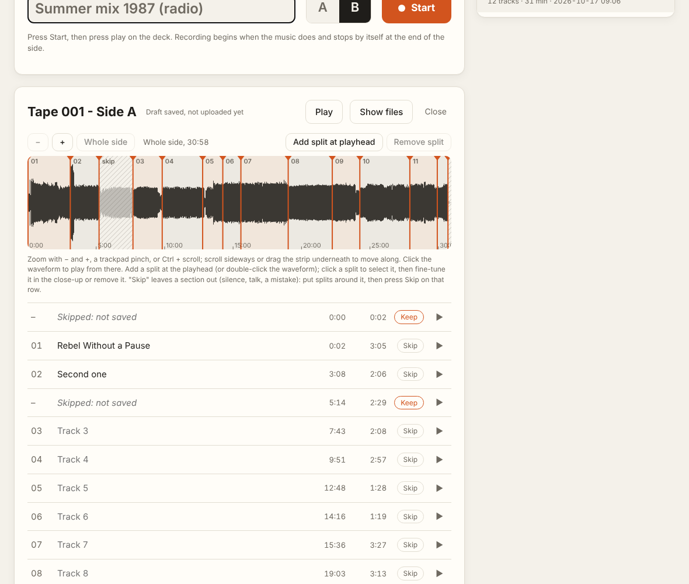
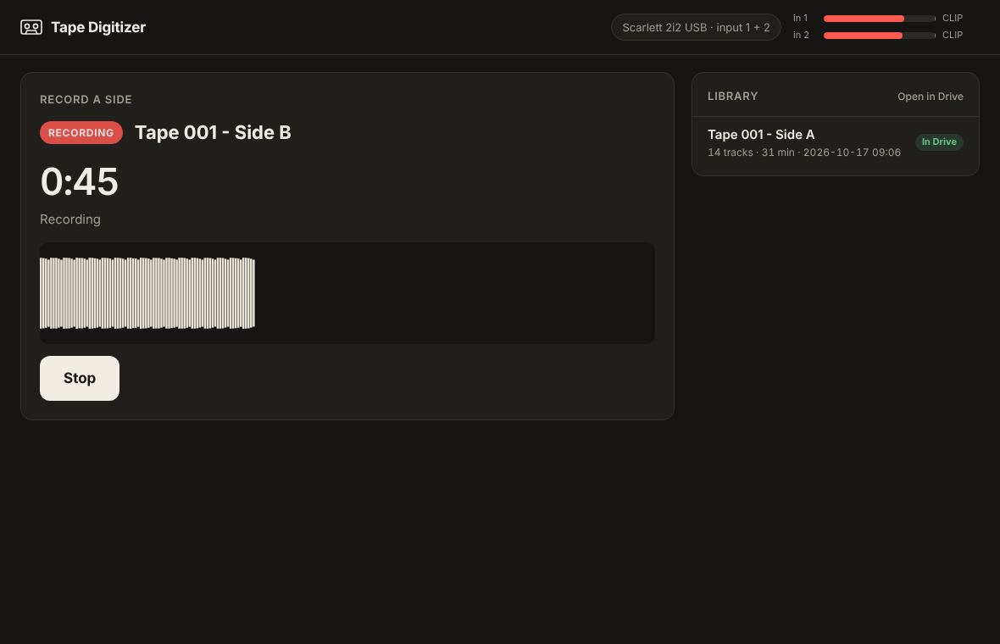

# Tape Digitizer

Digitize a pile of audio cassettes without babysitting each one. Press Start,
press play on the deck and walk away. When the side ends, Tape Digitizer has
recorded it, split it into tracks and saved them as tagged MP3s in your Google
Drive (or any other folder).

It was built for a box of 80s hip hop tapes: home-recorded albums with short
pause-button gaps, and mixtapes with no gaps at all. It handles both, and gives
you an editor to fix the splits it isn't sure about.

## Features

- **Hands-free recording.** Recording starts when the music does and stops by
  itself after 20 seconds of silence (the end of the side). The whole side is
  kept as a 24-bit FLAC master.
- **Automatic splitting.** Cuts go in the middle of the gaps between songs. Each
  gap is judged against the music around it, so short pause-button dips are
  found even over tape hiss. Seamless mixes are split where the music changes
  character instead, and marked "Check splits".
- **Auto-trim.** The leader before the first note, the run-out after the last
  and long silences are left out.
- **A side editor.** Zoom into the waveform; drag, nudge, add or remove splits;
  listen across a cut; skip sections (talk, a mistake); name the tracks; and
  undo or redo any of it. Save a half-done edit for later, or save and upload.
- **Record now, review later.** Every side goes into a library, so you can
  record side after side and come back to the splits whenever you like.
- **Saved where you want them.** 320 kbps MP3s tagged with album and track
  number, one folder per tape and side, plus a `log.csv` of every finished side.
  With Google Drive for desktop installed, they go straight to
  `My Drive/Music/Tapes/` and upload by themselves.
- **Any audio interface.** Pick the device and which inputs to record from
  (stereo or mono); the choice is remembered.
- **Listen while it records.** Level meters for each input, and a Listen
  switch that plays the incoming signal through the Mac's speakers or
  headphones, with its own volume.

## Requirements

- macOS (built and tested on an Apple Silicon Mac). The recorder and splitter
  are plain Python and should work on Linux and Windows too; the double-click
  launcher and the Drive folder detection are Mac-specific.
- Python 3.10 or newer.
- A cassette deck and an audio interface (developed with a Focusrite Scarlett).
- Optional: [Google Drive for desktop](https://www.google.com/drive/download/).
- The app opens as a window in Chrome, Edge or Brave if one is installed,
  otherwise in a tab of your default browser.

## Install

    git clone https://github.com/PhilippeGuyard/tape-digitizer.git
    cd tape-digitizer
    bash setup.sh

`setup.sh` creates a private Python environment in `.venv` with numpy, scipy,
soundfile, sounddevice and librosa.

## Using the app

Double-click **Tape Digitizer.command** in Finder. The first time, macOS may
ask whether to open it: right-click it, choose Open, then Open. (From a
terminal, `./tape app` does the same.)

1. Click the input chip at the top to choose your interface and inputs. Set the
   deck or interface gain so loud parts peak around −6 dB on the meters.
   Click **Listen** to hear the deck through the Mac's current sound output;
   the slider next to it sets the volume. It doesn't affect the recording.
2. Type a tape number (it becomes "Tape 012") or a name ("Summer mix 1987"),
   pick side A or B, and press **Start**. For a tape with no name yet, click
   **No name yet?**: it's saved as "Unnamed 001", "Unnamed 002" and so on (a
   separate count from tape numbers, so write it on the cassette), and side B
   of the same tape follows on. Rename it once you know what it is.
3. Press play on the deck and leave it. The side records, splits and saves.
   Then press **Record the next side**.
4. Later, open any side in the library. Sides marked **Check splits** have
   guessed cuts.

In the editor:

- Zoom by sliding two fingers up and down on the trackpad, by pinching, or
  with − and +. Swipe sideways to move along. Click the waveform to play from
  there; P (or the Play button) plays and pauses.
- **Add split at playhead** (S, or double-click the waveform). Click a split to
  select it, then drag it, nudge it by 0.1 s or 1 s, listen across it, or
  remove it (Delete).
- **Skip** on a row leaves that section out. It isn't saved and gets no track
  number. **Keep** brings it back.
- **Undo** / **Redo** (⌘Z / ⇧⌘Z), and **Reset all** goes back to the last save.
- **Save for later** keeps your edits without cutting or uploading anything
  (edits are also kept automatically a few seconds after each change).
- **Save and upload** re-cuts the side and replaces its MP3s.
- **Rename** next to the side's title changes its tape name or side letter.
  If the side is already in Drive, it's saved again under the new name.

Closing the Terminal window that opens with the app quits it.

Turn off auto-reverse on the deck: if it flips to side B by itself, the
silence that ends a recording never comes.

## Command line

Everything the app does is also available from the terminal:

    ./tape devices          # list audio devices and how many inputs each has
    ./tape choose           # pick the device and inputs (e.g. 1,2 stereo or 1 mono)
    ./tape levels           # live level meter
    ./tape calibrate        # play blank tape for 10 s, get suggested thresholds
    ./tape record 42 A      # record, split and save one side
    ./tape split 42 A       # re-split a side that's already recorded
    ./tape export 42 A      # save a side's MP3s again
    ./tape import 42 A FILE [RIGHT_FILE]   # bring in an existing recording
    ./tape set-drive FOLDER # save somewhere other than Google Drive

Useful options:

- `record --no-split` to only record, and `--no-upload` on `record`, `split` or
  `import` to keep the tracks on the Mac.
- `record --silence-db -48` if your tapes are noisy and a side never ends;
  `--end-silence 30` if quiet passages end a side too early.
- `--device Scarlett --inputs 3,4` on any recording command to use a different
  source once.
- `import` takes one stereo file, or two mono files (left first), such as the
  separate left and right recordings a DAW makes.

## Where files go

| What | Where |
| --- | --- |
| Work files: the FLAC master, `tracks.txt` (the splits) and FLAC tracks | `~/TapeDigitizer/work/Tape 042 - Side A/` |
| MP3s, tagged with album "Tape 042 Side A" and track numbers | `<Drive>/Music/Tapes/Tape 042/Side A/` |
| Full-side FLAC master | `<Drive>/Music/Tapes/Masters/` |
| A row per finished side, flagging the ones to check | `<Drive>/Music/Tapes/log.csv` |
| Settings (device, inputs, destination) | `~/TapeDigitizer/config.json` |

A FLAC master is about 300 MB per side. To keep masters on the Mac only, set
`"masters_to_drive": false` in `~/TapeDigitizer/config.json`.

## How splitting works

1. **Gaps.** The level of the recording is compared with the median of the 20
   seconds around it. A dip of 18 dB or more lasting at least 0.3 s is a gap,
   and the cut goes in its middle. Anything near true silence counts as a gap
   too.
2. **Changes.** If a long stretch has no gaps (a seamless mix), the splitter
   looks for points where the timbre and rhythm change (a novelty curve over
   librosa features) and cuts there. These are estimates, so the side is
   marked "Check splits" and gets a `CHECK ME.txt`.
3. **Trim and skip.** The leader, the run-out and silences of 8 s or more are
   marked as skipped sections.

The splits live in `tracks.txt`, an
[Audacity label file](https://manual.audacityteam.org/man/importing_and_exporting_labels.html).
If you prefer Audacity to the built-in editor, import the master and the labels,
move them, export the labels back over `tracks.txt`, then run
`./tape split 42 A --edited`.

### Song recognition (optional)

`split --recognize` and `import --recognize` look songs up with
[AudD](https://audd.io) to name tracks and refine cuts in mixes. Put your API
token in the `AUDD_API_TOKEN` environment variable or in `audd_token.txt`
(ignored by git). It's off by default: AudD recognized none of the obscure
tracks it was tried on, so it's only worth it for better-known releases.

## Development

    .venv/bin/pip install pytest
    .venv/bin/python -m pytest

The tests never touch your audio devices, your Drive or AudD.

The app is a small standard-library HTTP server (`tapedigitizer/app.py`) on
127.0.0.1:8765 with a single-page UI (`tapedigitizer/static/index.html`).
The modules:

- `recorder.py`: sound-activated recording and the end-of-side detector.
- `splitter.py`: gap and change detection, trimming, labels, cutting.
- `exporter.py`: MP3 encoding, tagging, the Drive folder and the log.
- `recognize.py`: optional AudD lookups.
- `cli.py`: the `./tape` commands.

## License

[MIT](LICENSE)
